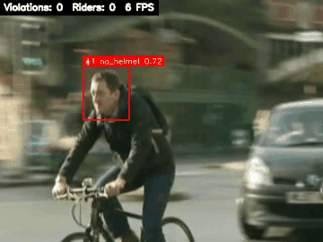
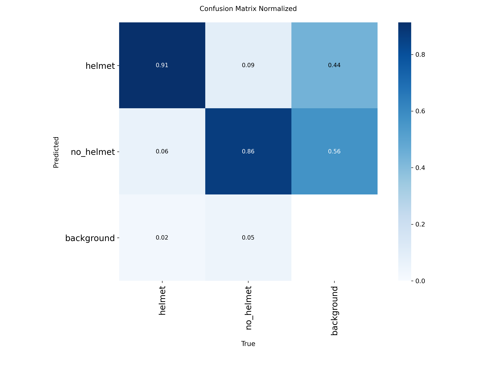
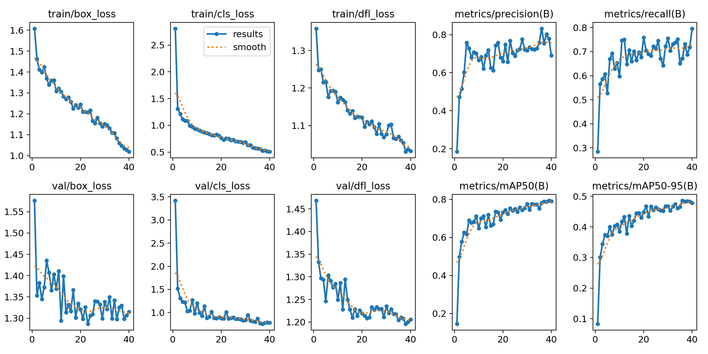
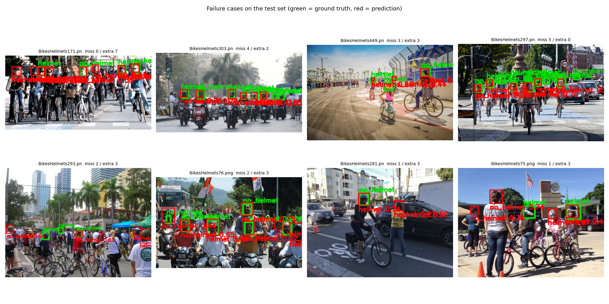
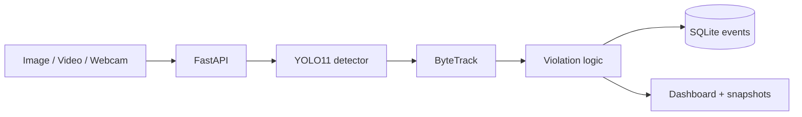

# Helmet Violation Detection & Tracking

Detects riders **with / without helmets** in images, videos and a live webcam, tracks each rider with **ByteTrack**,
and logs every confirmed violation (timestamp, track ID, confidence, snapshot) to **SQLite**.



**Live demo:** _add your Hugging Face Space link here_

## Results (held-out test set)

Model: `B_n_unfrozen_s1` (best seed of the best setup, selected on **validation** mAP50-95; the test set was used only for the final report).

| Precision | Recall | mAP@0.5 | mAP@0.5:95 | Params |
|---|---|---|---|---|
| 0.693 | 0.815 | 0.785 | 0.471 | 2.61 M |

Per-class AP@0.5: helmet 0.823, no_helmet 0.747

### Ablation: mean ± std over 3 seeds
| setup        |   seeds | val mAP50-95   | test precision   | test recall   | test mAP50    | test mAP50-95   |
|:-------------|--------:|:---------------|:-----------------|:--------------|:--------------|:----------------|
| A_n_frozen   |       3 | 0.466 ± 0.005  | 0.730 ± 0.026    | 0.809 ± 0.036 | 0.775 ± 0.008 | 0.452 ± 0.008   |
| B_n_unfrozen |       3 | 0.471 ± 0.009  | 0.714 ± 0.019    | 0.799 ± 0.026 | 0.785 ± 0.004 | 0.460 ± 0.012   |

_With only about 115 test images, small differences between runs can be noise._

<details><summary>All runs</summary>

| run             |   params_M |   val mAP50-95 |   test precision |   test recall |   test mAP50 |   test mAP50-95 |   GPU ms (val, model only) | selected   |
|:----------------|-----------:|---------------:|-----------------:|--------------:|-------------:|----------------:|---------------------------:|:-----------|
| A_n_frozen_s0   |       2.61 |          0.472 |            0.735 |         0.768 |        0.765 |           0.443 |                        4.1 |            |
| A_n_frozen_s1   |       2.61 |          0.464 |            0.753 |         0.823 |        0.779 |           0.454 |                        3.5 |            |
| A_n_frozen_s2   |       2.61 |          0.463 |            0.701 |         0.836 |        0.78  |           0.458 |                        3.6 |            |
| B_n_unfrozen_s0 |       2.61 |          0.473 |            0.732 |         0.769 |        0.781 |           0.461 |                        3.6 |            |
| B_n_unfrozen_s1 |       2.61 |          0.478 |            0.693 |         0.815 |        0.785 |           0.471 |                        3.7 | yes        |
| B_n_unfrozen_s2 |       2.61 |          0.461 |            0.716 |         0.812 |        0.79  |           0.447 |                        3.4 |            |

</details>

### Dataset split
| split   |   images |   helmet |   no_helmet |
|:--------|---------:|---------:|------------:|
| train   |      532 |      658 |         339 |
| val     |      114 |      167 |          55 |
| test    |      115 |      127 |          88 |

### Inference speed
| setup                 |   ms / frame |   FPS |
|:----------------------|-------------:|------:|
| PyTorch GPU (T4), 640 |         10.4 |  96.6 |
| PyTorch CPU, 640      |         56   |  17.9 |
| PyTorch CPU, 416      |         33.6 |  29.8 |
| ONNX Runtime CPU, 640 |         57.9 |  17.3 |

_Single-image, end-to-end latency (includes pre/post-processing). Numbers vary between runs and hardware._




## Error analysis (test set, IoU 0.5, conf 0.25)
Overall recall: **0.823** · false positives: **80** · missed boxes: **38**

Recall by object size
| bucket   |   boxes |   recall |
|:---------|--------:|---------:|
| small    |      72 |    0.639 |
| medium   |      71 |    0.887 |
| large    |      72 |    0.944 |

Recall by image brightness
| bucket   |   boxes |   recall |
|:---------|--------:|---------:|
| dark     |      72 |    0.778 |
| medium   |      72 |    0.875 |
| bright   |      71 |    0.817 |

Recall by class
| cls       |   boxes |   recall |
|:----------|--------:|---------:|
| helmet    |     127 |    0.858 |
| no_helmet |      88 |    0.773 |



_TODO: add 4-5 sentences of your own observations (what fails, why, what you would try next)._

## How violations are counted
Every rider gets a ByteTrack ID. A track becomes a **confirmed violation** once it is classified `no_helmet`
in at least `MIN_HITS` frames (default 5) and in at least 50% of its frames. Each track is logged **once**, with a snapshot.
Compliance rate = riders without a violation / confirmed riders.

## Architecture


## API
| Endpoint | Purpose |
|---|---|
| `POST /api/detect/image` | detect helmets in an image |
| `POST /api/detect/video` | track riders and log violations in a video |
| `WS /ws` | live webcam detection |
| `GET /api/runs`, `/api/events`, `/api/stats` | history and analytics |
| `GET /docs` | interactive API documentation |

## Run it
```bash
pip install -r requirements.txt
uvicorn app.api:app --port 8000      # open http://localhost:8000
```
Docker: `docker build -t helmet . && docker run -p 7860:7860 helmet`
Tests: `pip install -r requirements-dev.txt && pytest -q` (6 passed in 4.62s)

## Limitations
- Small dataset (about 761 images): results are noisy and may not transfer to other cameras, countries or lighting.
- The model detects `helmet` / `no_helmet` per person or head; it does not link a rider to a specific motorcycle or detect triple riding.
- ID switches or occlusion can double-count a rider; `MIN_HITS` reduces, but does not remove, false violations.
- Webcam inference runs on the server, so speed depends on the host and network.
- Check the dataset licence before redistributing the data or weights.

## Dataset
*Helmet Detection* (Kaggle, `andrewmvd/helmet-detection`), converted from Pascal VOC to YOLO format, with a seeded 70/15/15 split.
